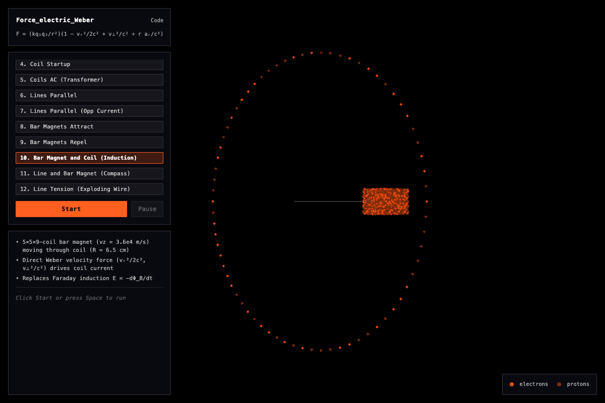

### Force_electric_Weber
- Simulate charges with force formula by Weber
- Model electrons, protons, wires (lines and coils), bar magnets (as stacked coils)
- Calculate forces with exact SI units

Note: wires (lines), coils, bar magnets are modeled as custom objects (wire segment objects). The sim electrons drift along fixed protons without computing internal forces (can model inside the atom in a future project).

---
### Formula
`F = (kq₁q₂/r²)(1 − ṙ²/2c² + r r̈/c²) = (kq₁q₂/r²)(1 − vᵣ²/2c² + v⊥²/c² + r aᵣ/c²)`

Note: careful with scalar, vectors, dots, doubledots. See code in `calc_forces()`

---
### Configs
1. Wire (line) and lone electron attraction
2. Wire (coil) and lone electron deflection
3. Wire (line, AC) and lone electron induction
4. Coil Startup
5. Coils AC (Transformer)
6. Wires parallel attraction
7. Wires parallel opp current repulsion
8. Bar magnets attraction
9. Bar magnets repulsion
10. Bar magnet and coil induction
11. Current (line) tilts bar magnet compass
12. Wire (line) longitudinal tension

---
### Why?
- Charge-to-charge force. Elegant.
- Formula by Weber builds on formulas by Coulomb (kq₁q₂/r² force between charges) and Ampère (force between wires), and can replace formulas by Biot, Savart, Faraday, Lenz, Neumann, Lorentz
- Can describe all macro electric and magnetic phenomena
- Features
  - Direct (without the B assist field)
  - Instant (not retarded)
  - Pairwise (charge-to-charge, push or pull on the line between them)

---
### More info
- Wikipedia https://en.wikipedia.org/wiki/Weber_electrodynamics
- Talks by André Assis
- [README_long.md](./README_long.md)

---
### Run
- Open `index.html`
